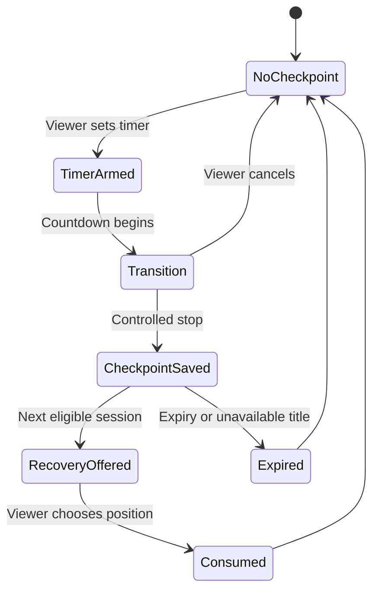

# Checkpoint Feasibility and Failure Model

**Assessment date:** 2026-11-08  
**Evidence label:** Technical design and prototype finding — not production proof

## Feasibility conclusion

A local, profile-scoped checkpoint is feasible as a prototype and a plausible pilot design. The prototype now demonstrates versioned persistence, reload recovery, a 30-day expiry, corrupt-state removal, and a separate standard-position choice.

Production feasibility is not yet proven across Netflix device platforms. Secure platform storage, lifecycle behaviour, certification, telemetry, and playback-service integration would require authorized engineering work.

## Design principle

The After Hours checkpoint must never silently overwrite the platform's normal playback position. It is a separate, temporary proposal shown to the viewer at the next session.

## Proposed minimum state

| Field | Purpose | Treatment |
| --- | --- | --- |
| `schema_version` | Safe future migration | Required |
| `profile_scope_id` | Prevent cross-profile exposure | Required; non-guessable internal identifier |
| `title_id` and `episode_id` | Resolve the content | Required |
| `checkpoint_ms` | Timer transition position | Required |
| `standard_position_ms` | Explain the alternative position | Read at recovery time where possible |
| `timer_type` | Duration or end-of-episode | Required for explanation and analysis |
| `created_at` | Recency and audit context | Required |
| `expires_at` | Automatic minimization | Required; proposed 30-day prototype value |
| `schema_version` | Parse and migration safety | Required |
| `status` | Saved, consumed, dismissed, expired | Required in production design |

No health, wearable, inferred sleep-stage, biometric, or medical data belongs in the pilot state.

## Storage and synchronization boundary

- **Pilot proposal:** local app storage, scoped to profile and device.
- **Source of truth:** the streaming platform's normal playback position remains authoritative.
- **Cross-device behaviour:** no After Hours checkpoint appears on another device in the first viable release.
- **Later option:** account synchronization requires privacy, security, retention, concurrency, and service-availability review.
- **Prototype implementation:** browser `localStorage` is a demonstrator only, not the recommended production storage mechanism.

## Failure behaviour

| Failure | Viewer-safe behaviour | Telemetry requirement |
| --- | --- | --- |
| Local write fails | Stop may continue; do not promise recovery; normal position remains available | `checkpoint_save_failed` with reason class, no sensitive payload |
| State is corrupt or version unsupported | Ignore and remove the After Hours state | `checkpoint_discarded` |
| Checkpoint expired | Do not show recovery card | `checkpoint_expired` |
| Content unavailable | Hide After Hours choice and use ordinary platform journey | `checkpoint_content_unavailable` |
| Profile changed | Never show another profile's checkpoint | `checkpoint_profile_mismatch` aggregate only |
| Newer ordinary position exists | Show both positions with clear labels or suppress stale checkpoint according to approved rule | `checkpoint_superseded` |
| Viewer cancels transition | Do not create a new checkpoint | `transition_cancelled` |
| Application closes during transition | Persist only an atomic, valid record; otherwise fall back to normal position | `transition_interrupted` |
| Storage is cleared | No recovery card; normal playback continues | No error presented as data loss |
| Multiple checkpoints for one title | Keep the latest valid controlled stop for that profile/title in the pilot | `checkpoint_replaced` |

## Privacy and security assessment

Playback position is behavioural data even without health information. Apply:

- data minimization;
- profile isolation;
- local encryption or protected app storage where the platform provides it;
- expiry and deletion;
- no diagnostic logs containing raw profile identifiers or title history;
- no inference that a viewer slept;
- clear dismissal; and
- fail-safe fallback to the standard playback experience.

## Technical spike result

The prototype source implements:

- key `after-hours-pilot-checkpoint-v1`;
- schema version 1;
- profile and title scope fields;
- checkpoint and standard-position fields;
- 30-day expiry;
- invalid/expired state removal; and
- rendering after reload.

The implementation proves that the state model can be represented in the portfolio prototype. It does not prove behaviour on smart TVs, native mobile applications, streaming sticks, consoles, browsers, or real playback services.

